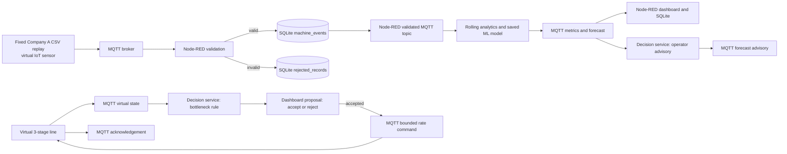

# Analytics and ML: Team 12 explanation

## The question we can answer from the fixed dataset

Company A contains timestamped machine records with item counts, status, power
and a reported cycle-time indicator. We use those to answer two **observed**
questions:

1. Is each machine performing below **its own** normal productive rate?
2. How many items is it likely to produce in the **next 30 minutes**?

The file does not identify a product route through machines, queue lengths,
waiting times or finished-line throughput. We therefore detect the limiting
stage and test control actions in a clearly labelled **virtual line**. The
forecast can lead to an operator advisory, not a claim that a physical
machine was controlled.

Company B is processed on a separate MQTT, Node-RED and SQLite path. It has
operating states and power readings but no item-count label, so the Company A
regression models are not scored on B. The A/B dashboard chart compares a
shared conditional Alarm-versus-Production measure over nine full months;
it does not rank factory throughput.

Company B has its own three-model classification study: logistic regression,
gradient boosting and a neural network predict the next reported state when
the next record arrives exactly one dataset minute later. A forward-time
validation block selected gradient boosting by macro F1 (0.962). On the later
test block it scored 0.941, below the simple same-state baseline (0.948).
The dashboard presents both results. This classification score cannot be
compared numerically with Company A's item-count MAE.

For the teacher's two-laptop deployment, the dataset publishers and virtual
actuator run on the device laptop. Node-RED, SQLite, analytics, models,
dashboard and decision engine run on the cloud laptop. Both connect to the
same online HiveMQ broker; see [TWO_LAPTOP_DEMO.md](TWO_LAPTOP_DEMO.md).

## Actual live workflow



The dashboard is a view of stored data, so it is shown alongside analytics
rather than treated as a data processor. Analytics receives a record only
after Node-RED validation and a successful SQLite write. A rejected record
cannot advance a rolling metric, a forecast or an advisory.

## Step 1: data audit and cleaning

- We keep the raw CSV unchanged and verify its fixed SHA-256.
- The observed reporting interval is mainly **five minutes**.
- We flag extreme power readings and inconsistent cycle-time readings.
- We preserve missing five-minute slots as gaps; we do not interpret a
  missing report as zero output.
- Each machine is compared with its own productive history. Machines make
  different products, so direct item-count ranking is not meaningful.

See DATA_AUDIT.md and ASSUMPTIONS.md for the measured values and limits.

## Step 2: rolling analytics

For each machine, the last six distinct five-minute slots form a 30-minute
window. We calculate item count, items per productive slot, productive
share, alarm share, coverage and ratio to its own hour-of-day baseline.
A low-output alert needs several consecutive low slots. A sustained alarm
state is treated as interruption. Incomplete coverage gets an
insufficient-data message instead of a false slowdown.

These rules are transparent and operate on the real replay.

## Step 3: one fair task for three different algorithms

**Target:** total items that a machine will produce during the next six
five-minute slots (30 minutes).

**Inputs:** 45 features built only from the previous six slots: lagged
items, productive share, alarm share, power and cycle-time indicator;
recent item summaries; hour/day; and one-hot machine identity. A full
consecutive history is required in live operation. Offline training drops
any example whose history or target touches a gap.

All three candidates use exactly the **same examples and target**:

1. **Ridge regression (traditional ML):** regularized linear prediction.
   Fast and easy to explain; limited at nonlinear interactions.
2. **Histogram gradient boosting (ensemble ML):** many sequential trees.
   Learns nonlinear thresholds and interactions.
3. **Two-hidden-layer MLP neural network (deep learning):** layers of 32 and
   16 ReLU units, trained with Adam on scaled inputs. It is a modest
   feed-forward network, not a large language model or sequence model.

Simple always-zero, last-30-minutes persistence and machine/hour-average
references are reported as checks. They are not the three trained model
families.

## Step 4: select before using the test period

The split is chronological: 487,520 training examples, 91,338 validation
examples, then 102,992 later test examples. A 25-minute purge at each
boundary prevents a forecast target from crossing into the next period.
Nothing in this step looks at the test period.

### Why one validation block was not enough

Scored on the single validation block, the three families land like this:

- Ridge: **2.007** items
- Gradient boosting: **1.698** items
- Neural network: **1.735** items
- Persistence reference: **2.067** items

Gradient boosting leads the neural network by 2.2%, and the tie-break rule
triggers at 2%. The entire choice of model therefore rested on a margin of
0.2 percentage points measured on one seven-week window. That is not a
result anyone should defend in a viva.

### Rolling-origin cross-validation

Selection now runs on **four rolling-origin folds** inside the pre-test
period. Each fold trains on an expanding prefix and scores the stretch of
time immediately after it, always forwards, with the same label embargo:

| Model | fold 1 | fold 2 | fold 3 | fold 4 | mean |
|---|---:|---:|---:|---:|---:|
| gradient boosting | 2.139 | 1.693 | **1.556** | **1.568** | **1.739** |
| neural network | **2.072** | **1.671** | 1.661 | 1.653 | 1.764 |
| Ridge | 2.231 | 2.001 | 1.886 | 1.921 | 2.010 |

This is the honest picture the single block was hiding: **the ranking
flips.** The neural network wins the first two folds and gradient boosting
wins the last two. The two are genuinely close.

### What breaks the tie, and why

The idle share climbs steadily through the file - 14%, 34%, 38%, 72% across
the four validation folds, and 81% in the test period. The data drifts, so
the **latest fold is the closest thing we have to "how will this behave
next month"**.

The selection rule is therefore, in order:

1. lowest mean across folds wins outright, unless another model is within 2%;
2. inside that margin, the better **most recent fold** wins;
3. only if that is also a tie does the smaller saved model win.

Gradient boosting is 1.45% ahead on the mean (a tie) and **5.43% ahead on
the most recent fold** (decisive). Model size never enters the decision,
which is right: size is a deployment convenience, not evidence about
accuracy.

### Idle MAE: the error Active MAE cannot see

Active MAE only looks at windows where the machine produced something. A
model could score well there and still promise output from a stopped
machine, sending operators to chase work that is never coming. So we also
report **Idle MAE** - how much output a model wrongly predicts on windows
where the machine produced nothing - and the share of idle windows where it
promises more than one item:

| Model | Test Active MAE | Test Idle MAE | promises >1 item while idle |
|---|---:|---:|---:|
| gradient boosting (shipped) | **2.338** | 0.369 | 6.1% |
| neural network | 2.392 | 0.519 | 13.8% |
| Ridge | 2.936 | 1.009 | **37.0%** |
| persistence reference | 3.109 | **0.201** | 1.0% |

Two things are worth saying out loud. Ridge wrongly promises production on
**more than a third** of idle windows, which the old table could not show.
And persistence is the *best* model at recognising that a stopped machine
stays stopped - it just cannot forecast a running one.

### The model we ship

Once gradient boosting was selected, it was refit on **all pre-test data**
(training plus validation). Selection was already locked, so this cannot
leak the test period; it simply lets the shipped model learn from the most
recent weeks too. That helped every measure:

| Fitted on | Test Active MAE | Test Idle MAE | Test MAE |
|---|---:|---:|---:|
| training block only | 2.346 | 0.390 | 0.767 |
| all pre-test data (shipped) | **2.338** | **0.369** | **0.748** |

On the held-out test the shipped model beats persistence on Active MAE
(**2.338** vs 3.109) **and** on overall MAE (**0.748** vs 0.761). The
earlier version lost the overall comparison; it no longer does.

The selected fitted model and exact feature order are saved in
results/chosen_model.joblib. The live analytics service loads that file,
publishes a 30-minute forecast, and the decision service compares it with
that machine's productive baseline before issuing an **operator
recommendation**. The forecast record stores the selected model name in
SQLite.

## Step 4b: proving the live model sees the training numbers

A forecast is only trustworthy if the numbers fed to the model at run time
mean the same thing as the numbers it learned from. Those two paths are
built by different code:

```
TRAINING   company_A.csv -> clean.to_slots()          -> ml_features.build_for_asset()
LIVE       MQTT records  -> analytics.update_history() -> ml_features.features_from_live_rows()
```

`scripts/verify_feature_parity.py` replays real Company A records through
the live path and compares every one of the 45 model inputs against the
training table at the same origin. The current run checks 1,500 real
windows - **67,500 feature comparisons, zero mismatches** - including 113
slots that hold more than one record and 50 with a flagged power or
cycle reading, which synthetic test data never exercises.

```powershell
.\.venv\Scripts\python.exe scripts\verify_feature_parity.py --samples 1500
```

## Step 5: actual bottleneck decision and action

The virtual line has three assumed stages and queues. The deterministic
detector requires high busy share, a long **growing** queue and several
consecutive checks before naming the limiting stage. If a stage is stopped,
it advises investigation rather than speeding it up. For a capacity
constraint it proposes a bounded rate change. The dashboard operator accepts
or rejects it. Only acceptance sends a MQTT command, which the virtual
actuator acknowledges.

This stage-order and queue evidence comes from the simulator; the real
Company A file cannot validate it. The before/after comparison holds
random arrivals constant. It is evidence for the simulated controller,
not a measured factory gain.

## What each teammate should demonstrate

- **Data owner:** show the raw-file checksum, a data-quality flag, and why
  five-minute gaps matter.
- **IoT owner:** show raw MQTT -> Node-RED validation -> SQLite -> validated
  MQTT. Inject a bad record and show it enters rejected_records only.
- **Analytics/ML owner:** explain six-slot metrics, all three algorithms,
  the chronological split and embargo, Active MAE *and* Idle MAE, the
  rolling-origin folds, and why gradient boosting was chosen even though it
  does not win every fold. Be ready to run
  `scripts\verify_feature_parity.py` to show the live features match the
  training features.
- **Decision owner:** show a low forecast producing an advisory; then show
  a simulated Stage 2 growing queue producing a proposal, then accept it to
  show a bounded command and ack. Reject a later proposal to show no actuation.
- **Presenter:** keep observed-machine claims and virtual-line claims
  separate on every slide.

## Reproduce and demonstrate

From the extracted project directory after setup:

```powershell
.\.venv\Scripts\python.exe tests\test_logic.py
.\.venv\Scripts\python.exe scripts\run_demo.py slowdown --reset-db --once --speed 1000
.\.venv\Scripts\python.exe scripts\check_demo.py
```

The Desktop folder includes the unchanged Company A CSV, prepared features,
selected model and replay slice, so the live demo does **not** need retraining.
To reproduce the full comparison from the fixed source file:

```powershell
.\.venv\Scripts\python.exe scripts\fetch_dataset.py
.\.venv\Scripts\python.exe src\clean.py
.\.venv\Scripts\python.exe src\ml_features.py
.\.venv\Scripts\python.exe src\ml_train.py
.\.venv\Scripts\python.exe scripts\update_dashboard.py
.\.venv\Scripts\python.exe scripts\verify_feature_parity.py
```

The model report is generated at results/MODEL_RESULTS.md. Training now
includes four cross-validation folds, so it takes a few minutes longer than
a single fit; `ml.cv_folds` in config/config.yaml controls that.

